<p align="center">

</p>

# JellyBridge Plugin

[](https://github.com/kinggeorges12/JellyBridge/stargazers)
[](https://github.com/kinggeorges12/JellyBridge/releases/latest)
[](LICENSE)
[](https://kinggeorges12.github.io/JellyBridge/)

A Jellyfin plugin that bridges Jellyfin with Jellyseerr (and Seerr\*) for seamless movie and series discovery and download requests.

## 📣 Changes coming in Version 6.0
- More JellyBridge libraries! Release date is December 2nd. You will see a pop-up notice of the upgrade to your JellyBridge libraries. Read about it in [PR #84](https://github.com/kinggeorges12/JellyBridge/pull/84).


## ✨ Features

- **Native Jellyfin Support**: Whether you use Android TV or Kodi to sync videos and favorites with Jellyfin, this plugin has you covered
- **New Discover Content**: Updates movies and series listings from selected networks (e.g., Netflix), Trending, or New Releases
- **Make Jellyseerr Requests**: Enables requesting new movies and series directly from a Jellyfin library, making this accessible from mobile apps, Android TV, and even Kodi Sync Queue!
- **More Content**: Integrates with [Jellyseerr's existing services](https://docs.seerr.dev/using-jellyseerr/settings/services) when you mark movies or series as favorites in Jellyfin
- **Scheduled Tasks**: Automatically syncs movies and series on a configurable schedule and on Jellyfin startup
- **Search Integration**: Provides Jellyseerr results directly in the native Jellyfin search
- **Smart Exclusion**: Uses native Jellyfin configuration files to exclude movies and series that already exist in your other Jellyfin libraries
- **Shuffle Content**: Native support on Android TV for random or smart-sort for browsing discover content, always fresh!

## 🧩 Jellyfin Integration

The plugin integrates seamlessly with Jellyfin, displaying shuffled discover content that users can browse and mark as favorites to request downloads. Check the [🖇️ Compatibility](Version.md) page for version-specific information.

Get Jellyfin here: [jellyfin.org](https://jellyfin.org/). For setup, see the official [installation guide](https://jellyfin.org/docs/general/installation/).

### 📖 Library View
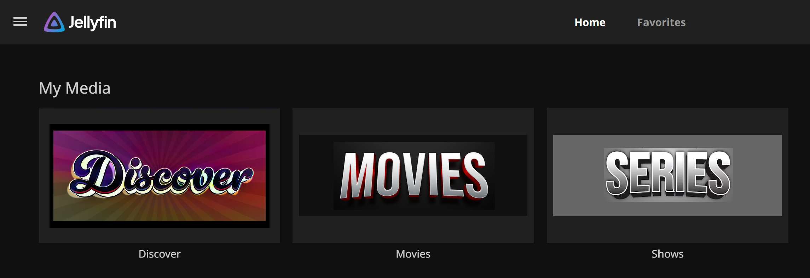

The plugin manages libraries and folders in Jellyfin, creating structure for discovered content.

### 📚 Items View
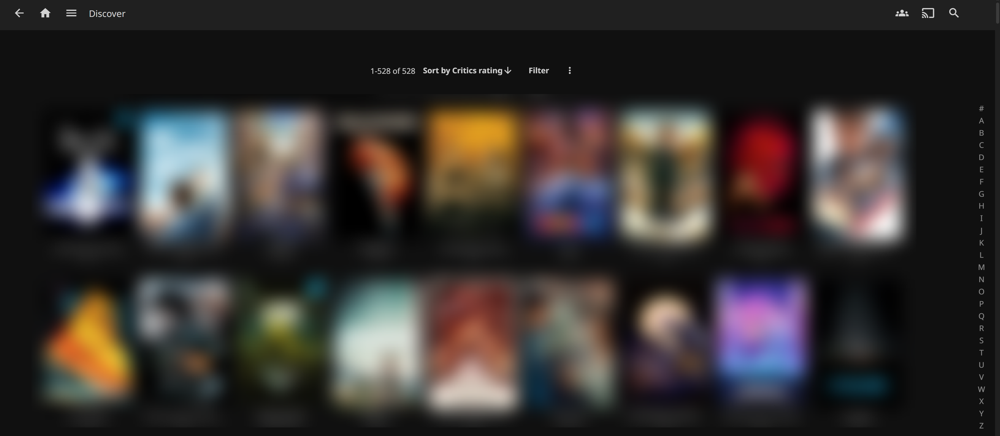

Browse all discovered movies and series from Jellyseerr networks with thumbnails and metadata.

### 🗃️ Sorting

To see the intended order, set the JellyBridge library sort to **Play count** (Ascending). This works using the task to sort discover content, which updates play counts to create a dynamic browsing order.
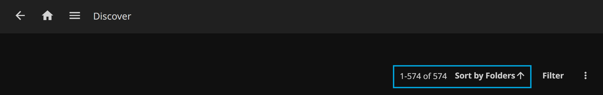

### 📲 Jellyseerr Integration

The plugin seamlessly integrates with Jellyseerr to manage download requests and track availability of movies and series.

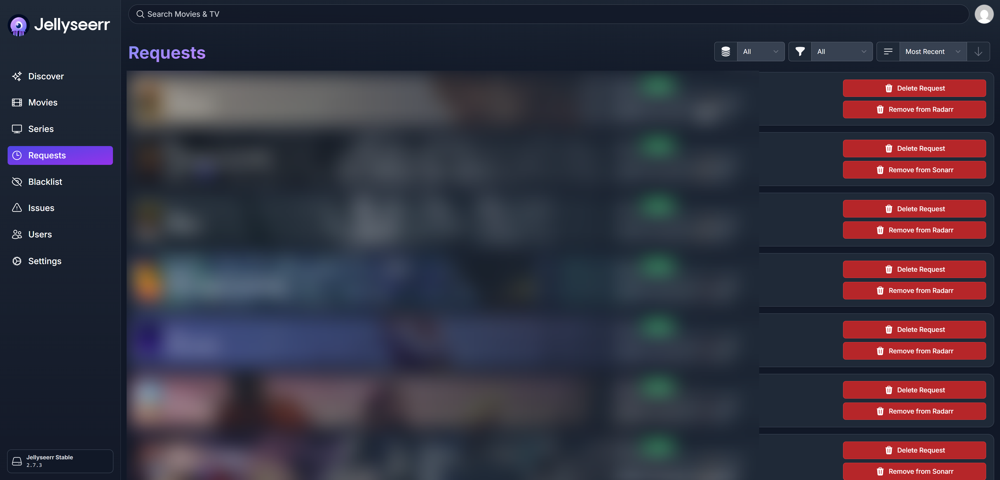

When users mark movies or series as favorites in Jellyfin, the plugin automatically sends download requests to Jellyseerr for processing. The user who requested the content is shown in Jellyseerr as the requestor, all you have to do is import the Jellyfin users. Any integrations with [Jellyseerr's existing services](https://docs.seerr.dev/using-jellyseerr/settings/services) can manage the content creation in Jellyfin. After content is requested, the movie or series is hidden from the JellyBridge library.

Get Jellyseerr here: [seerr.dev](https://seerr.dev). For setup, see the official [installation guide](https://docs.seerr.dev/getting-started).

*Note*: To enable approval of requests created by JellyBridge ([see related issue](https://github.com/kinggeorges12/JellyBridge/issues/17#issuecomment-3572018193)), you must use a patched version of Jellyseerr 2.7.3 in this Docker image: `kinggeorges12/jellyseerr:latest`

After installing Jellyseerr, disable the JellyBridge library to prevent requests from being marked as Available.
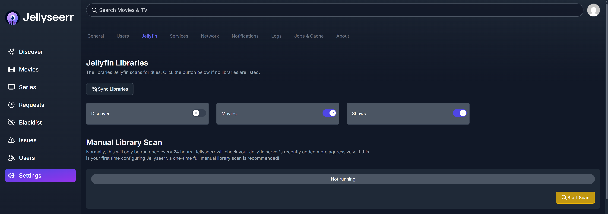

### 📺 Kodi Sync Plugin for Jellyfin

Browse with Kodi and request content from Jellyfin via the Jellyfin add-on.

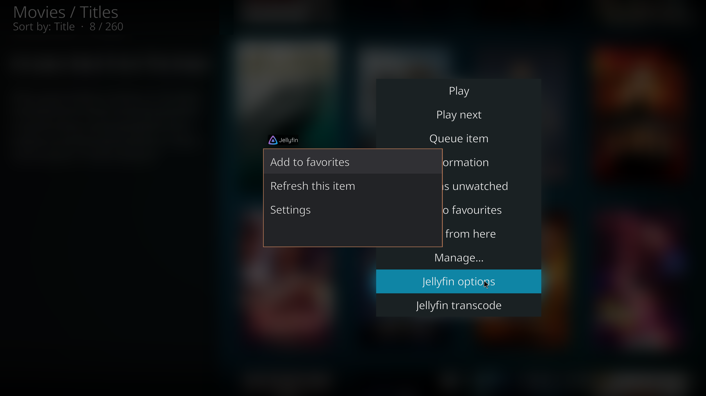

For Kodi add-on setup, see the official [Jellyfin Kodi client docs](https://jellyfin.org/docs/general/clients/kodi/). Restart Kodi after installing the Jellycon add-on to load the native Jellyfin context (right-click) menu. For faster Jellyfin performance, install [Kodi Sync Queue](https://github.com/jellyfin/jellyfin-plugin-kodisyncqueue). *Note*: Search Integration is only compatible with Jellycon.

- **Discover Content**:
   - Jellycon: Open Add-ons → Video Add-ons → Jellycon → Jellyfin Libraries → JellyBridge Library (Movies or Series) → Show All
   - Jellyfin for Kodi: Open Add-ons → Video Add-ons → Jellyfin → JellyBridge Library (Movies or Series) → Random Items / Recommended Items / any other view
- **Jellyseer Requests**:
   - Jellycon → Open any Library view → right-click a movie or series → Set Favourite
   - Jellyfin for Kodi → Open any Library view → right-click a movie or series → Jellyfin options → Add to favorites
   - If Request Seasons is enabled → Request a specific season by opening any series and adding the season to favorites
- **Search Integration**: Jellycon → Add-on Actions → Search → Movies / TV Shows → enter search terms → right-click a movie or series → Set Favourite

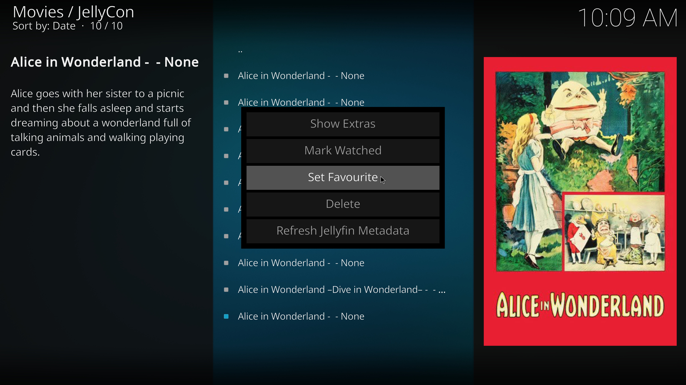

## 📦 Installation

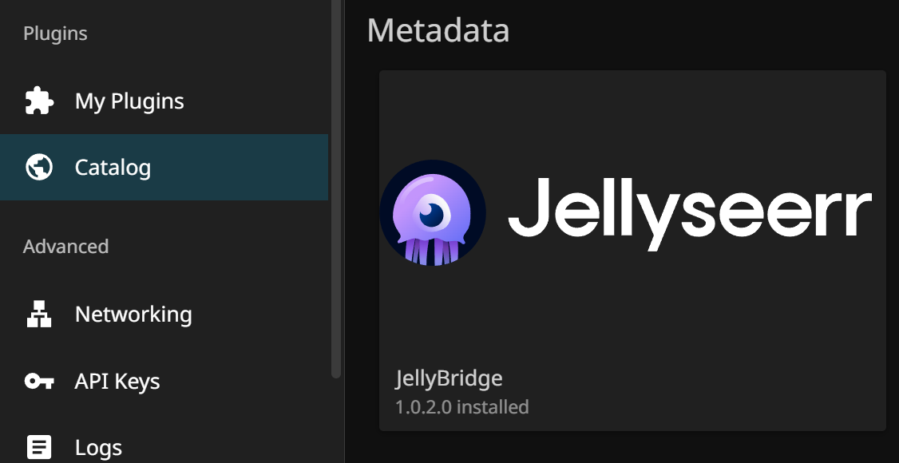

1. **Add Plugin Repository to Jellyfin:**
   - Go to Jellyfin Admin Dashboard → Plugins → Catalog
   - Click ⚙️ icon (Jellyfin 11: "Manage Repositories" button)
   - Click "Add Repository" button (Jellyfin 11: "New Repository" button)
   - Enter Repository Name: JellyBridge
   - Enter Repository URL: <button onclick="navigator.clipboard.writeText('https://raw.githubusercontent.com/kinggeorges12/JellyBridge/refs/heads/main/manifest.json')">📋Copy</button>
   ```
   https://raw.githubusercontent.com/kinggeorges12/JellyBridge/refs/heads/main/manifest.json
   ```
   - Click "Add"

2. **Install Plugin:**
   - Go to Plugins → Catalog (Jellyfin 11: Plugins → Available)
   - Find "JellyBridge" under Metadata (Jellyfin 11: Other)
   - Click "Install"
   - Restart Jellyfin from the Dashboard

3. **Configure the plugin** through the admin interface

### 🔢 Versions
For best compatibility, install the version listed first on the plugin page. The wonky Jellyfin plugin versioning does not let me change the visibility. Please follow the guide below for installing the correct plugin version.
- For users of Jellyfin 12.0 and later, install the version ending in `.12.0`.
- For users of Jellyfin 10.11.9 and later, install the version ending in `.11.9`.
- For users of Jellyfin 10.11.0 to 10.11.8, install the version ending in `.11.0`.
- For users of Jellyfin 10.10.\*, install the version ending in `.10.7`.
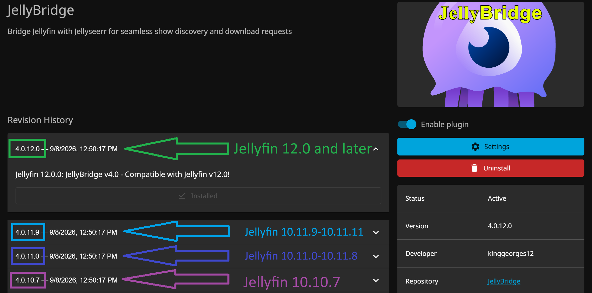

## 🛠️ Configuration

Access the configuration using the plugin page on the host machine at: `http://localhost:8096/web/#/configurationpage?name=JellyBridge`

1. **Configure the plugin** through the plugin page with your Jellyseerr credentials and directory paths
2. **Create discover library** in Jellyfin by following steps for one-time setup, just click on the (?) Setup button
3. **Test the connection** to ensure Jellyseerr is accessible
4. **Import discover content** to browse movies and series from Jellyseerr
5. **Mark movies or series as favorites** in Jellyfin to automatically request downloads
6. **Customize promo video** play a short video when users open JellyBridge content
7. **Sort & shuffle content** to display a variety of discover content in the discover library

### 🌉 General Settings

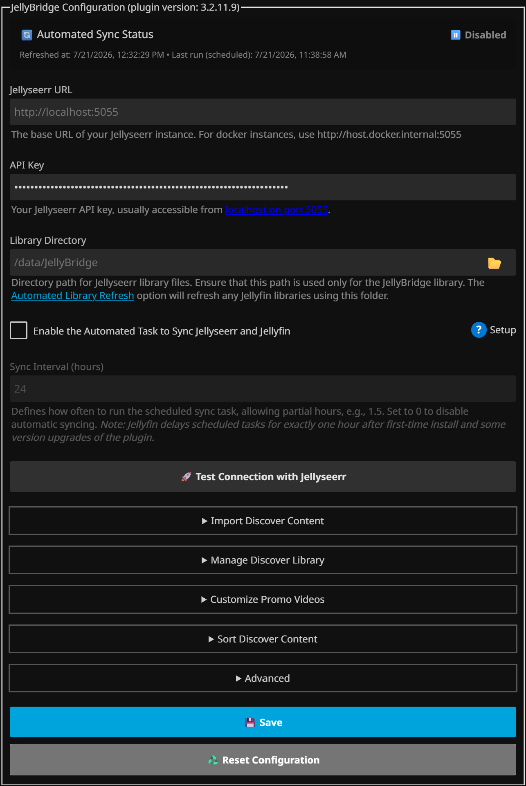

- **Automated Sync Status**: Displays the current sync status, current progress, last sync time, and next scheduled sync time
- **Plugins Menu**: Displays a link to the JellyBridge configuration page on the sidebar Plugins menu
- **Jellyseerr URL**: The web address where your Jellyseerr instance is accessible to Jellyfin
- **API Key**: Authentication key that allows the plugin to communicate with Jellyseerr
- **Library Directory**: The dedicated directory for this plugin where JellyBridge stores media content and metadata
- **Enable the Automated Task to Sync Jellyseerr and Jellyfin**: Turns on automatic syncing on a schedule
- **Sync Interval (hours)**: How often the plugin automatically syncs content
- **Test Connection with Jellyseerr**: Verifies that the plugin can successfully connect to your Jellyseerr instance
- **Library Setup Instructions**: Click the "(?) Setup" button next to the automated task checkbox to view library setup instructions and troubleshooting

### ✨ Organize Discover Library

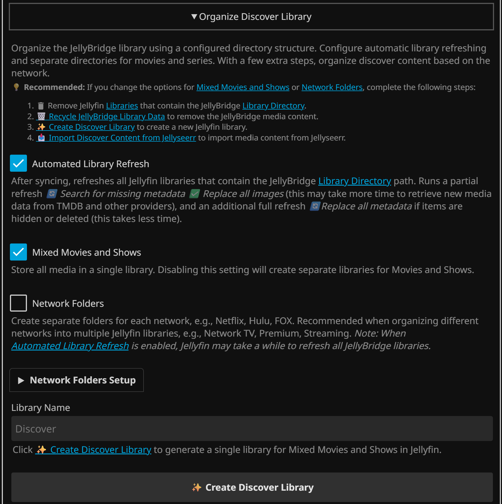

- **Automated Library Refresh**: Automatically refreshes all Jellyfin libraries containing the JellyBridge library directory after each sync
- **Mixed Movies and Shows**: Creates a single Jellyfin libraries as Mixed Movies and Shows
- **Network Folders**: Creates separate folders for each selected network so you can organize them into different Jellyfin libraries
- **Library Name**: Specifies the name when creating a new Jellyfin library
- **Create Discover Library**: Create a new Jellyfin library using the default settings

### 🔍 Import Discover Content

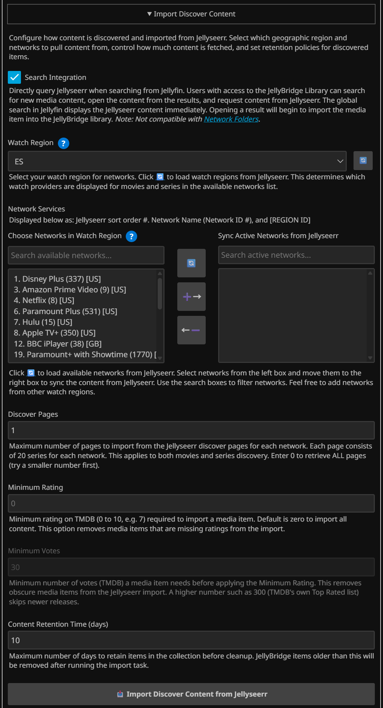

- **Search Integration**: Add Jellyseerr results to the Jellyfin search and import discover content when opening media content
- **Watch Region**: Which geographic region to search for available networks
- **Network Services**: Choose networks to import discover content from
- **Discover Pages**: The number of pages to import per network
- **Minimum Rating**: The lower limit for ratings on TMDB (1-10 stars) when importing media content
- **Minimum Votes**: The minimum rating must have at least this many votes on TMDB before importing media content
- **Content Retention Time (days)**: How long to keep discover content before automatic cleanup
- **Import Discover Content from Jellyseerr**: Manually trigger the task to sync media content

### ⭐ Manage Favorite Requests

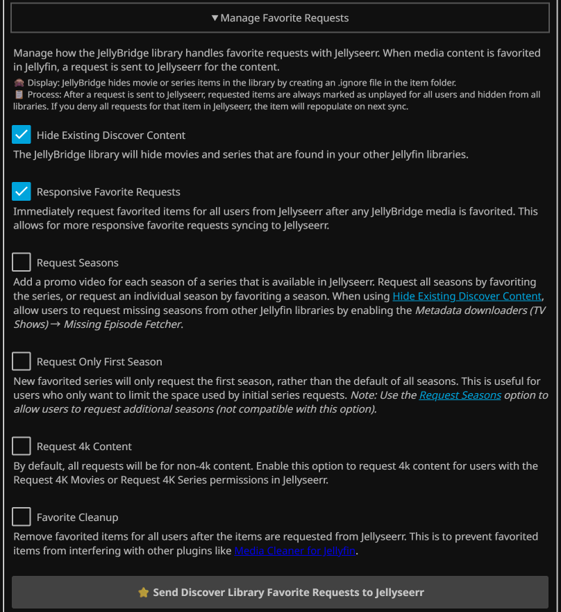

- **Hide Existing Discover Content**: Excludes movies and series from the JellyBridge library if they already exist in your other Jellyfin libraries
- **Request Seasons**: Allow users to request individual seasons from a series
- **Request Only First Season**: New favorited series will only request the first season instead of the entire series
- **Request 4k Content**: Request 4k media content if the Jellyseerr user has permission
- **Responsive Favorite Requests**: Send requests to Jellyseerr immediately when favoriting items
- **Favorite Cleanup**: Unfavorite items from the JellyBridge library after requesting them from Jellyseerr
- **Send Discover Library Favorite Requests to Jellyseerr**: Manually trigger the task to sync favorites

### 🎥 Customize Promo Videos

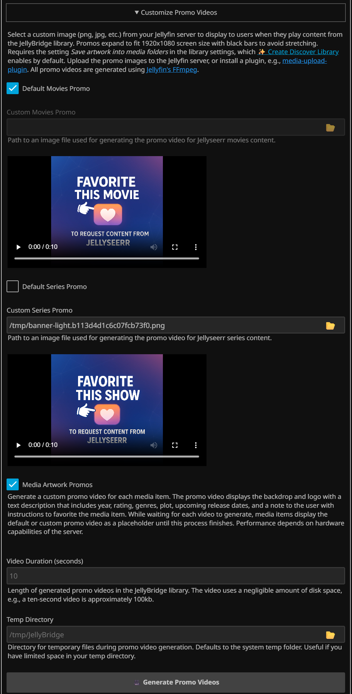

- **Custom Movies & Series Promo**: Select an image file to generate the promo video for movies and series content
- **Default Movies & Series Promo**: The pre-packaged promo video for JellyBridge
- **Media Artwork Promos**: Customize each movies and series promo video with artwork from the media content
- **Promo Video Duration**: A short video to teach users how to request the discover content
- **Temp Directory**: Storage for generating promo video files, usually the operating system default
- **Generate Promo Videos**: Replace existing promo videos with the custom or default for all movies and series

*Note: The plugin generates promo videos for movies and series from Jellyseerr. The custom promo image generates a short, customizable promo video using Jellyfin's FFmpeg.*

### 🔀 Sort Discover Content
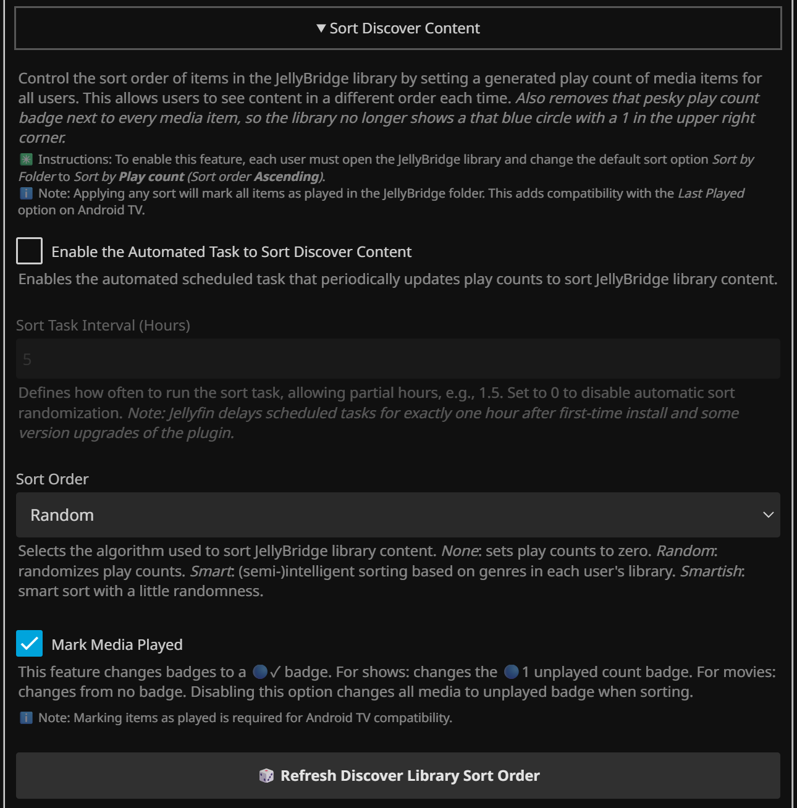

- **Enable the Automated Task to Sort Discover Content**: Periodically updates play counts to drive sort order for all users
- **Sort Task Interval (hours)**: How often to run the sort task
- **Sort Order**: Choose algorithm
  - **None**: Sets all play counts to zero
  - **Random**: Randomizes play counts
  - **Smart**: Semi-intelligent ordering based on genres in each user's library
  - **Smartish**: Smart ordering with a little randomness
- **Mark Media Played**: Change 🔵 badge appearance in the JellyBridge library
- **Refresh Discover Library Sort Order**: Manually apply the selected algorithm immediately

**Instructions**: To see the sorted order, each user must open the JellyBridge library and change the default sort option *Sort by Folder* to *Sort by **Play count** (Sort order **Ascending**)*. For Android TV users, sort by ***Last Played***. Not recommended for Kodi, which already has a feature for random and recommended sorting.

### ⚙️ Advanced Settings

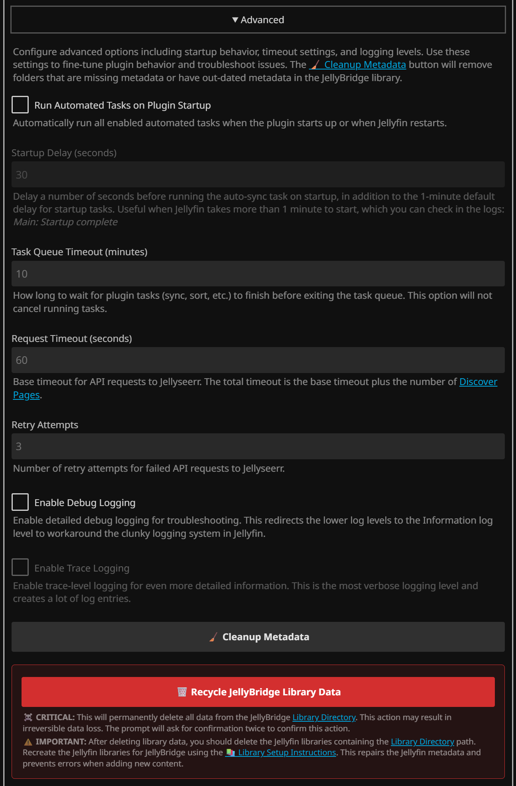

- **Run Automated Tasks on Plugin Startup**: Runs all enabled automated tasks when Jellyfin starts
- **Startup Delay (seconds)**: How many long to wait before running the startup tasks
- **Task Queue Timeout (minutes)**: How long to wait for queued JellyBridge tasks to start behind running tasks
- **Request Timeout (seconds)**: Jellyseerr API requests wait time
- **Retry Attempts**: Number of retry attempts for failed API requests to Jellyseerr
- **Enable Debug Logging**: Normal logging
- **Enable Trace Logging**: Huge logs
- **Cleanup Metadata**: Button to manually clean up metadata in the JellyBridge library
- **Recycle JellyBridge Library Data**: Permanently deletes all data from the JellyBridge library directory

## 🛟 Troubleshooting

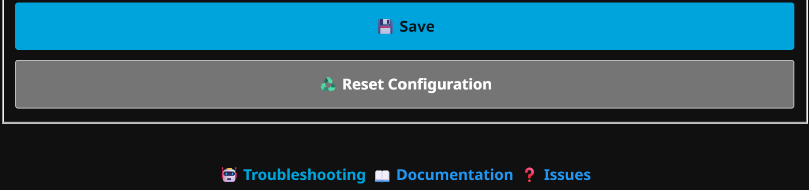

Click the 🤖 Troubleshooting link on the bottom of the plugin configuration page. This section contains basic steps, including how to set up the JellyBridge library.

- Enable Debug or Trace logging from the ⚙️ Advanced Settings to record detailed logs. The plugin integrates with Jellyfin's logging system.
- For additional help with plugin setup, check out [issues with the debugging tag](https://github.com/kinggeorges12/JellyBridge/issues?q=is%3Aissue%20label%3Adebugging).
- If the config UI doesn’t reflect the latest changes after an update, force-refresh the page (see Release Notes for steps).

If you encounter any issues with the plugin, please post in the [GitHub Issues](https://github.com/kinggeorges12/JellyBridge/issues) or leave a comment in [GitHub Discussions](https://github.com/kinggeorges12/JellyBridge/discussions).

## 🅰️ℹ️ AI Disclosure and Use Statement

The Jellyfin Team published the [Jellyfin LLM/"AI" Development Policy](https://jellyfin.org/docs/general/contributing/llm-policies/) on January 22, 2026. I want to publish my own note for transparency and guidance to contributors of this project.

I used AI tools to assist in the development of this project, mostly using OpenAI GPT-4.1 in Visual Studio Code. I have read every line of code that was generated and I took steps to deliberately construct the project. Every single word that you read of instructions was polished by yours truly, so you don't have to listen to clankers with zero aesthetic. I would not have attempted this project without AI help, but it would not actually run without lots of human effort.

I welcome all efforts from the Jellyfin community that wishes to contribute to this project. Anyone who has used AI tools to code knows that it programs at the level of a first year developer, but it does help to structure the code and build prototypes. I ask that everyone keeps this in mind when building code with the LLMs, and run tests on your code. Also, understand that I have spent hundreds of hours working on this project, but I do not expect you to. Please do what you can to contribute and grow your favorite Jellyfin projects.

## 📌 Acknowledgments

Thank you to the creator of the [Overseer-Jellyfin Bridge Script](https://github.com/geekfreak21/Overseer-and-Jellyfin-Bridged) for the inspiration. Special thanks to the developers of the [Intro Skipper](https://github.com/intro-skipper) and [Custom Tabs](https://github.com/IAmParadox27/jellyfin-plugin-custom-tabs) plugins for reusing their GPL-licensed code in the UI styling and configuration patterns.

And of course, thanks to the developers of [Jellyfin](https://jellyfin.org/) and [Jellyseerr](https://seerr.dev/) for making it all possible.

For detailed development instructions, including building, testing, and contributing, see [Development.md](Development.md).
